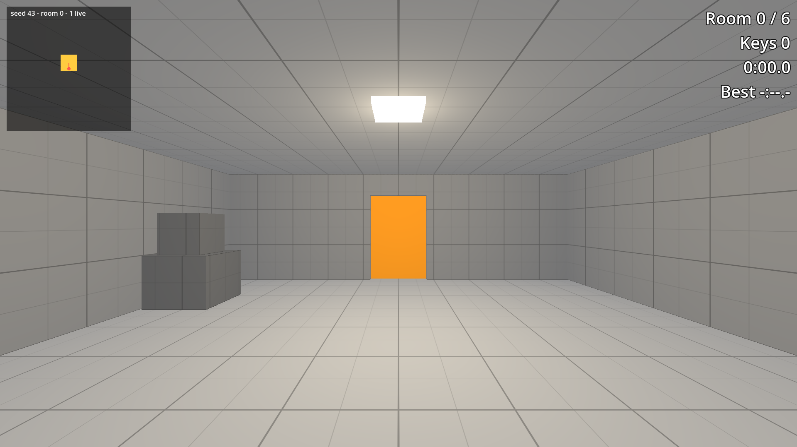

# Room Contents in Godot 4

Project files for tutorial 05 of the Godot 4 series by Phaix on YouTube (https://www.youtube.com/@Phaix).

Fill a generated chain of rooms in Godot 4 without ever blocking the way: props on seeded markers with a random stream of their own, balance data in a Resource with a weighted pick, weighted room types, a rare vault with a spacing rule, and a headless check over a thousand seeds that proves every key, door and corridor stays clear. Every step is its own project folder.



## Steps

Every step of the video is its own folder in `steps/`, the exact state at the end of that
part. Open the project in Godot 4.7, then open `steps/<step>/main.tscn` and press F6 to run
that step. The project's main scene is the final step.

| Folder | Part of the video |
|---|---|
| `steps/step_00_start` | Starting point (the final state of the previous tutorial) |
| `steps/step_01_prop_spots` | Step 1 - Props on markers |
| `steps/step_02_prop_sets` | Step 2 - Prop sets |
| `steps/step_03_weighted_rooms` | Step 3 - Weighted rooms |
| `steps/step_04_rare_rooms` | Step 4 - A rare room |
| `steps/step_05_clear_paths` | Step 5 - Clear paths |

## Controls

WASD or arrow keys or the left stick to walk, mouse or right stick to look, Space to jump,
Esc gives the mouse back, a click captures it again. Further keys per tutorial are shown
in the video and in the HUD.

## Tests

```sh
godot --headless --path . -s res://tests/run_tests.gd
```

## License

Code and scenes: MIT (see LICENSE).
